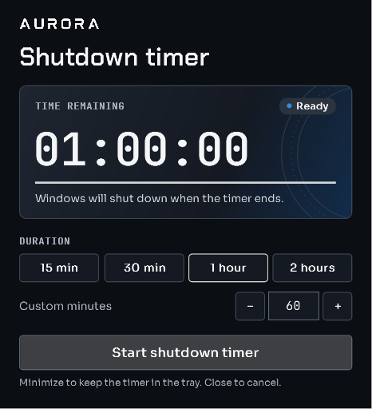

# Windows shutdown timer

Set a countdown to shut down your Windows PC. Choose a preset or enter 1 to 1440 minutes. You can pause the timer, resume it, or cancel it before Windows shuts down.

**[Download WindowsTimerApp.exe for Windows x64](https://github.com/wszaq/WinTimerApp/releases/latest/download/WindowsTimerApp.exe)** · [Release notes for v1.0.0](https://github.com/wszaq/WinTimerApp/releases/tag/v1.0.0)

Open the downloaded file. It includes the .NET runtime and runs without installation.



## Use the timer

1. Choose a duration and select **Start shutdown timer**. The app shows the planned shutdown time.
2. Minimize the window to keep the timer running in the system tray. Double-click the tray icon to open it again.
3. Select **Cancel timer** or close the app to cancel. If the countdown reaches zero, the app requests an immediate Windows shutdown.

## Run from source

On Windows, install the .NET 8 SDK. From the repository folder, run the following command.

```powershell
dotnet run --project WindowsTimerApp.csproj
```

## Help and development

- [User guide](docs/Getting-started.md) and [project wiki](https://github.com/wszaq/WinTimerApp/wiki)
- [Build, test, and package](docs/Reference.md)
- [How the timer works](docs/Architecture.md)
- [Report a problem](https://github.com/wszaq/WinTimerApp/issues)
