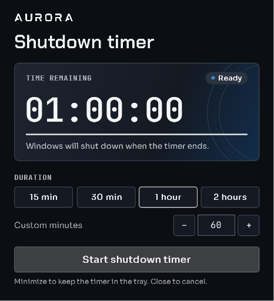

# Windows shutdown timer

Set a countdown to shut down your Windows PC. Choose a preset or enter 1 to 1440 minutes. You can pause the timer, resume it, or cancel it before Windows shuts down.



## What it is

WindowsTimerApp is a shutdown timer for Windows x64. It counts down the time that you choose. At zero, it asks Windows to shut down at once. The timer runs in the system tray when you minimize the window.

The app keeps the countdown in memory. Closing the app cancels the countdown.

## Quick start

### Download the app

1. Select **[Download WindowsTimerApp.exe for Windows x64](https://github.com/wszaq/WinTimerApp/releases/latest/download/WindowsTimerApp.exe)**. Release notes for v1.0.0 are at [GitHub releases](https://github.com/wszaq/WinTimerApp/releases/tag/v1.0.0).
2. Open the downloaded file. It includes the .NET runtime and runs without installation.
3. To check the file, follow the SHA-256 steps in the [user guide](docs/Getting-started.md).

### Run from source

On Windows, install the .NET 8 SDK. From the repository folder, run the following command.

```powershell
dotnet run --project WindowsTimerApp.csproj
```

To build and test, run these commands.

```powershell
dotnet build WindowsTimerApp.csproj
dotnet test tests/Timer.Tests.csproj
```

To make a standalone executable or an installer, see [Build, test, and package](docs/Reference.md).

## Usage

1. Choose a duration and select **Start shutdown timer**. The app shows the planned shutdown time.
2. Select **Pause timer** to stop the countdown. Select **Resume timer** to continue from the remaining time.
3. Minimize the window to keep the timer running in the system tray. Double-click the tray icon to open it again.
4. Select **Cancel timer** or close the app to cancel. If the countdown reaches zero, the app requests an immediate Windows shutdown.

Save your work before the countdown ends. At zero, the app requests a Windows shutdown without another prompt from the timer.

## Layout

- `Program.cs`: starts the app. It gives the window the shutdown action.
- `MainWindow.xaml` and `MainWindow.xaml.cs`: the window and its display.
- `TimerEngine.cs` and `TimerState.cs`: the countdown and its states.
- `TrayController.cs`: the tray icon and its menu.
- `WindowsTimerApp.csproj`: the app project.
- `tests/`: automated tests. The test project is `tests/Timer.Tests.csproj`.
- `installer/WindowsTimerApp.iss`: the Inno Setup script for the installer.
- `publish.sh` and `build_installer.sh`: scripts that publish the executable and build the installer.
- `Assets/`: bundled fonts and the logo.
- `docs/`: the [user guide](docs/Getting-started.md), the [build reference](docs/Reference.md), and the [architecture notes](docs/Architecture.md).

## Status

Version 1.0.0 is the latest public release. It includes the Windows x64 executable. The automated tests use a substitute shutdown action, so they do not shut down the test PC.

The project accepts bug reports and proposed changes. See [CONTRIBUTING.md](CONTRIBUTING.md) and [SECURITY.md](SECURITY.md).

## Help and development

- [User guide](docs/Getting-started.md) and [project wiki](https://github.com/wszaq/WinTimerApp/wiki)
- [Build, test, and package](docs/Reference.md)
- [How the timer works](docs/Architecture.md)
- [Report a problem](https://github.com/wszaq/WinTimerApp/issues)
